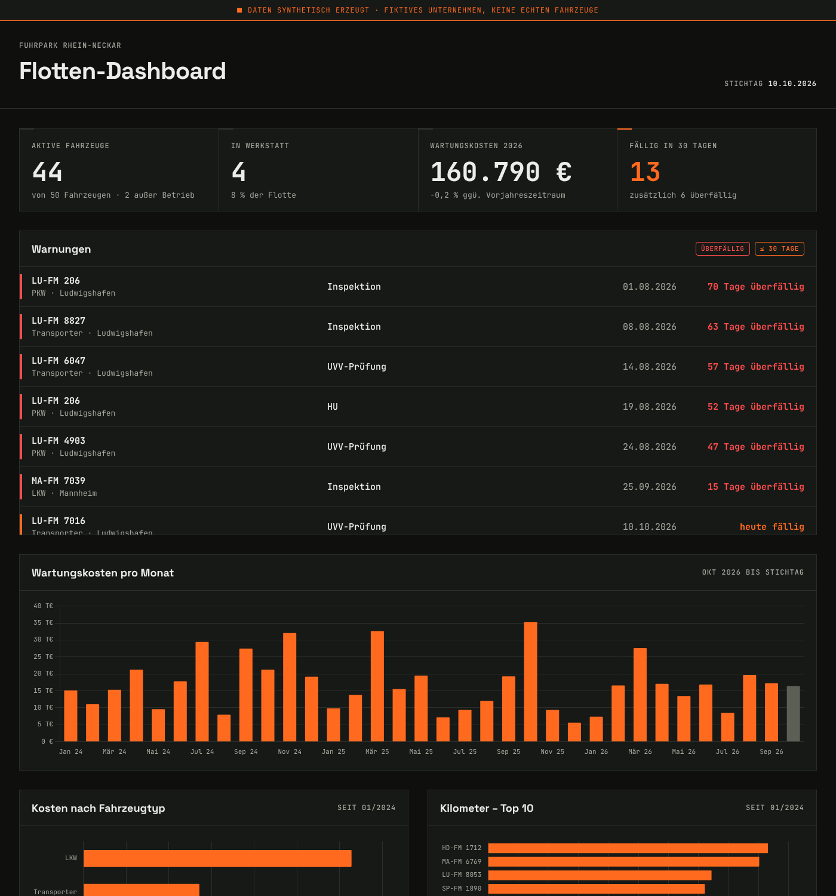

# Flotten-Dashboard

Ein Dashboard für das Flottenmanagement eines fiktiven Unternehmens mit fünf Standorten in der Region Rhein-Neckar. Es zeigt 50 Fahrzeuge mit ihren Wartungen, Kosten, Fahrleistungen und Prüfterminen und warnt, sobald etwas fällig wird.

> **Hinweis:** Alle Daten sind **synthetisch erzeugt**. Unternehmen, Fahrzeuge und Kennzeichen sind frei erfunden. Es werden keine echten Unternehmensdaten verwendet.



## Ziel

Das Projekt ist Teil meines Portfolios. Es zeigt den vollständigen Weg von den Rohdaten bis zur Auswertung:

- **Datengenerierung in Python** mit realistischen Regeln, festem Seed und dem heutigen Datum als Stichtag
- **Relationales Datenmodell in SQLite** mit Primär- und Fremdschlüsseln sowie CHECK-Constraints
- **SQL-Auswertungen** mit JOINs, CTEs, CASE-Pivot und Fensterfunktionen (`queries.sql`)
- **Frontend ohne Framework und ohne Build-Schritt** (HTML, CSS, JavaScript, Chart.js), lauffähig auf GitHub Pages

## Funktionen

| Bereich | Inhalt |
|---|---|
| Kennzahlen | Aktive Fahrzeuge, Fahrzeuge in der Werkstatt, Wartungskosten des laufenden Jahres (mit Vorjahresvergleich), Termine in den nächsten 30 Tagen |
| Warnungen | Überfällige Termine (rot) und Termine in den nächsten 30 Tagen (orange), nach Dringlichkeit sortiert |
| Diagramme | Wartungskosten pro Monat, Kosten nach Fahrzeugtyp, Top 10 der Fahrzeuge nach Kilometern |
| Fahrzeugtabelle | Volltextsuche, Filter nach Typ, Status und Standort, Sortierung per Klick auf die Spaltenköpfe |
| Detailansicht | Stammdaten, offene Termine und Wartungshistorie eines Fahrzeugs |

Weitere Eigenschaften:

- **Responsive:** vom Smartphone bis zum großen Bildschirm
- **Barrierearm:** vollständig per Tastatur bedienbar, sichtbarer Fokus, ausreichende Kontraste, Status nie nur über Farbe

## Die Daten

`generate_data.py` erzeugt vier Tabellen für den Zeitraum vom 01.01.2024 bis zum **Stichtag**. Der Stichtag ist das Datum, an dem das Skript ausgeführt wird. Die Zeilenzahlen unten beziehen sich auf einen Lauf am 10.10.2026:

| Tabelle | Inhalt | Zeilen |
|---|---|---|
| `fahrzeuge` | Kennzeichen, Typ (PKW, Transporter, LKW, Stapler), Marke, Modell, Baujahr, Kraftstoff, Standort, Status | 50 |
| `wartungen` | Inspektionen, Reparaturen, Reifenwechsel, Unfallschäden mit Kosten und Dauer | ca. 550 |
| `fahrten` | Kilometer und Verbrauch pro Fahrzeug und Monat | ca. 1.550 |
| `termine` | HU, UVV-Prüfung und Inspektion mit Fälligkeit und Erledigt-Status | ca. 460 |

Die Daten folgen realistischen Regeln:

- Transporter und LKW fahren deutlich mehr Kilometer als PKW.
- Kosten und Reparaturhäufigkeit steigen mit dem Fahrzeugalter. E-Fahrzeuge sind in der Wartung günstiger.
- Die HU ist für PKW und Transporter alle 24 Monate fällig (erstmals nach 36 bzw. 24 Monaten), für LKW alle 12 Monate. Die UVV-Prüfung ist jährlich fällig.
- Die Kennzeichen tragen das Kürzel des Standorts (LU, MA, HD, SP, FT). E-Fahrzeuge haben ein E-Kennzeichen.
- Einige Termine sind absichtlich überfällig oder stehen in den nächsten 30 Tagen an.

Der Stichtag ist das „Heute“ aus Sicht der Daten: Die Historie endet dort, und überfällige oder bald fällige Termine werden relativ zu diesem Datum berechnet. Standardmäßig gilt `STICHTAG = date.today()`, die Termine sind also bei jedem Lauf aktuell.

- Dank des festen Seeds (`SEED = 42`) liefern zwei Läufe **am selben Tag** exakt dieselben Daten. An einem anderen Tag entsteht ein neuer Datenstand.
- Für dauerhaft identische Daten (z. B. für Screenshots) `STICHTAG` in `generate_data.py` auf ein festes Datum setzen, etwa `date(2026, 10, 10)`.
- Das Dashboard rechnet mit dem Stichtag aus `daten.json`, nicht mit dem Datum des Browsers. Die Online-Version zeigt daher den Stand des letzten Laufs. Um sie zu aktualisieren: Skript ausführen, dann `git add -A`, `git commit` und `git push`.

## Projekt starten

Voraussetzung ist **Python 3.10 oder neuer**. Es werden keine zusätzlichen Pakete benötigt.

```bash
# 1. Daten erzeugen (CSV, SQLite-Datenbank und daten.json)
python generate_data.py

# 2. Lokalen Webserver starten
python -m http.server 8000
```

Danach im Browser **http://localhost:8000** öffnen.

Unter Windows funktioniert statt `python` auch `py`. Ein Doppelklick auf `index.html` reicht nicht, weil der Browser das Laden von `daten.json` über `file://` blockiert. Für die Diagramme wird eine Internetverbindung benötigt, da Chart.js über ein CDN geladen wird.

### SQL-Abfragen ausführen

Die Datenbank `daten/flotte.db` lässt sich zum Beispiel mit [DB Browser for SQLite](https://sqlitebrowser.org/) öffnen. Alternativ per Kommandozeile:

```bash
sqlite3 daten/flotte.db < queries.sql
```

`queries.sql` enthält acht kommentierte Abfragen:

1. Wartungskosten pro Fahrzeug
2. Top 10 der teuersten Fahrzeuge pro 1.000 km
3. Überfällige Termine
4. Termine in den nächsten 30 Tagen
5. Kosten pro Monat
6. Kosten nach Typ und Wartungsart
7. Reparaturkosten nach Altersklasse
8. Standortvergleich mit `RANK()`

## Veröffentlichung auf GitHub Pages

Da das Dashboard nur statische Dateien liest, genügt es, das Repository auf GitHub zu veröffentlichen und unter *Settings → Pages* den Branch `main` als Quelle zu wählen. `daten.json` ist bereits im Repository enthalten.

## Dateistruktur

```
flotten-dashboard/
├── generate_data.py   # Generator für die synthetischen Daten
├── daten.json         # Export für das Dashboard (vom Generator erzeugt)
├── daten/
│   ├── fahrzeuge.csv
│   ├── wartungen.csv
│   ├── fahrten.csv
│   ├── termine.csv
│   └── flotte.db      # SQLite-Datenbank mit denselben vier Tabellen
├── queries.sql        # Kommentierte SQL-Auswertungen
├── index.html         # Aufbau der Seite
├── style.css          # Gestaltung (Cockpit-Stil, responsive)
├── script.js          # Laden der Daten, Kennzahlen, Diagramme, Tabelle, Detailansicht
├── docs/
│   └── screenshot.png
└── README.md
```

## Technik

- **Python 3** (nur Standardbibliothek: `random`, `csv`, `sqlite3`, `json`)
- **SQLite**
- **HTML, CSS, JavaScript** (ohne Framework und ohne Build-Schritt)
- **[Chart.js 4](https://www.chartjs.org/)** über CDN
- Schriften **JetBrains Mono** und **Space Grotesk** über Google Fonts

---

*Alle Daten in diesem Projekt sind synthetisch erzeugt. Ähnlichkeiten mit realen Unternehmen oder Fahrzeugen sind zufällig.*
